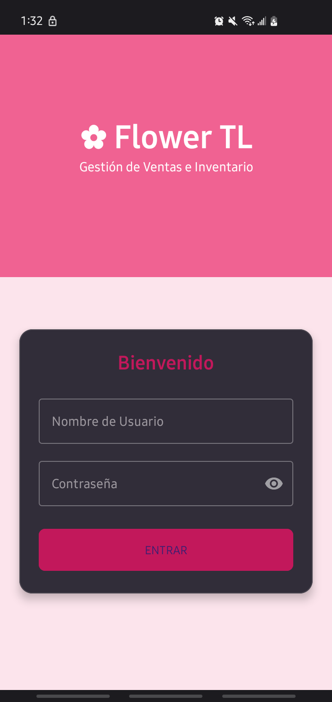
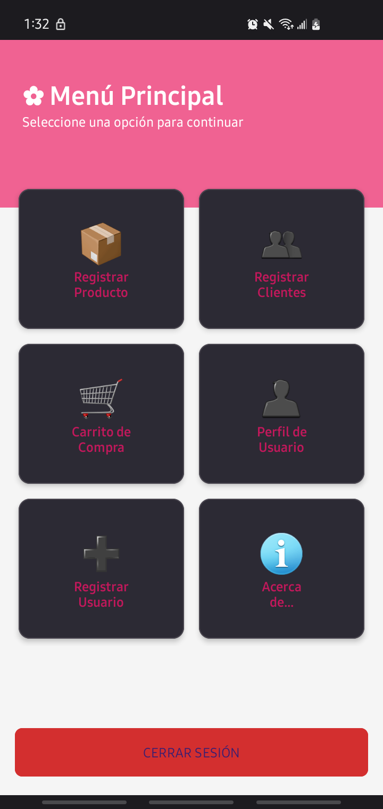
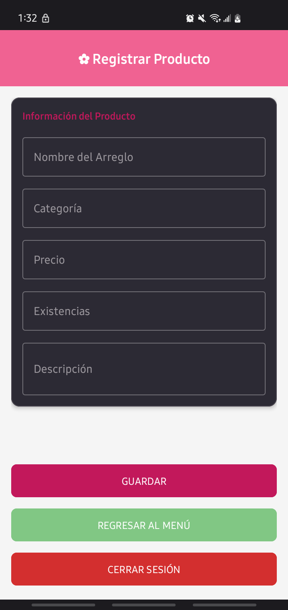
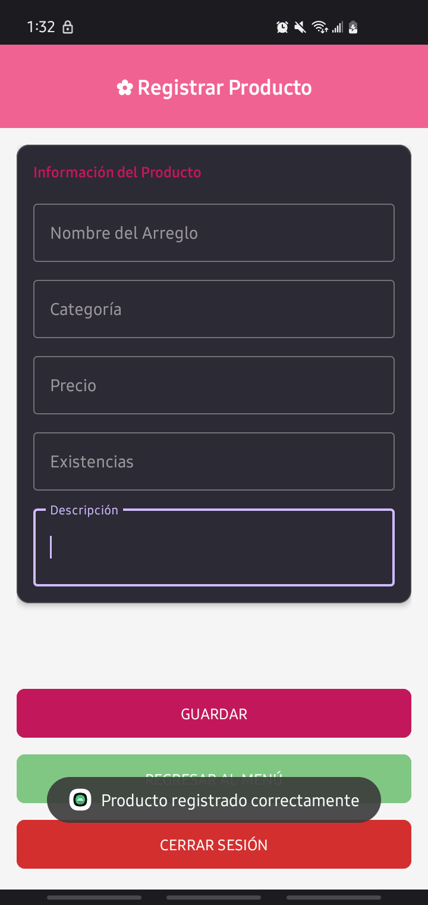

# FlowControl App

**Sistema de gestión móvil para ventas e inventarios de _flowers_lt_** — florería y detalles personalizados.

Aplicación Android en **Java** con arquitectura **MVC**, conectada a una **API REST en PHP** que guarda la información en **MySQL**. Proyecto de la materia Programación Móvil II (III Parcial), Universidad Tecnológica de Honduras, Campus Santa Bárbara.

---

## Capturas

<table>
  <tr>
    <td align="center"><br><b>Inicio de sesión</b></td>
    <td align="center"><br><b>Menú principal</b></td>
  </tr>
  <tr>
    <td align="center"><br><b>Registrar producto</b></td>
    <td align="center"><br><b>Producto guardado en la API</b></td>
  </tr>
</table>

---

## Funcionalidades

- **Inicio de sesión** contra la base de datos MySQL a través de la API. La sesión queda guardada en el dispositivo.
- **Menú principal** con acceso a todas las pantallas.
- **Registro de productos**: nombre, categoría, precio, existencias y descripción.
- **Registro de clientes**: nombre, identidad, teléfono y dirección. La identidad no puede repetirse.
- **Registro de usuarios**: usuario, contraseña, nombre completo, correo y rol (Administrador o Vendedor).
- **Perfil de usuario** con los datos de la sesión activa.
- **Mensajes de validación** y de error del servidor en cada formulario.

---

## Arquitectura

```
┌───────────────────────────── App Android (MVC) ─────────────────────────────┐
│  View (Actividades)  →  Controller (Controladores)  →  Model (Modelos)       │
│                                                            │                 │
│                                              Config/ClienteApi (Retrofit)    │
└────────────────────────────────────────────────────────────┬─────────────────┘
                                                             │ HTTP POST (form-data)
                                                             ▼
┌──────────────────────────── API REST (backend/) ────────────────────────────┐
│  Index.php → valida credenciales de la app → JRouter → Controllers → Models  │
└────────────────────────────────────────────────────────────┬─────────────────┘
                                                             │ PDO
                                                             ▼
                                              MySQL · base de datos FlowControl
```

Cada respuesta de la API tiene el mismo formato:

```json
{ "message": "Producto registrado correctamente", "success": true, "data": { "id": 1 } }
```

---

## Tecnologías

| Capa | Tecnología |
|---|---|
| Aplicación móvil | Android Studio, Java 11, Material Components, ViewBinding |
| Comunicación | Retrofit 2.11, Gson |
| Backend | PHP 8 con arquitectura MVC propia (basada en EndPoint) |
| Base de datos | MySQL / MariaDB (XAMPP) |
| Herramientas de prueba | Postman, SQLyog, adb |

---

## Estructura del repositorio

```
FlowControl-App/
├── app/                      # Aplicación Android
│   └── src/main/
│       ├── java/com/example/flowertl/
│       │   ├── Config/       # ApiConfig, ClienteApi, ServicioApi, respuestas, Configuracion
│       │   ├── Controller/   # Lógica de negocio y validaciones
│       │   ├── Empty/        # Entidades (eUsuario, eProducto, eCliente)
│       │   ├── Model/        # Acceso a la API (ModeloUsuario, ModeloProducto, ModeloCliente)
│       │   └── View/         # Actividades y pantallas
│       └── res/              # Layouts, colores, textos y recursos gráficos
├── backend/                  # API REST en PHP
│   ├── Config/               # Conexión a MySQL, autoload, router y request
│   ├── Controllers/          # UserController, ProductController, CustomerController
│   ├── Models/               # Api, User, Product, Customer
│   ├── Index.php             # Punto de entrada y validación de credenciales
│   └── FlowControl.sql       # Script de la base de datos
├── docs/screenshots/         # Capturas de la aplicación
└── gradle/                   # Catálogo de versiones y wrapper de Gradle
```

---

## Endpoints de la API

Todas las rutas son **POST** y reciben `username` y `password` (credenciales de la aplicación) en cada llamada.

| Endpoint | Parámetros | Descripción |
|---|---|---|
| `User/login` | `nombreUsuario`, `contrasena` | Valida al usuario y devuelve sus datos |
| `User/insertUser` | `nombreUsuario`, `contrasena`, `nombreCompleto`, `correo`, `rol` | Registra un usuario |
| `Product/getProducts` | — | Lista los productos |
| `Product/insertProduct` | `nombre`, `categoria`, `precio`, `existencias`, `descripcion` | Registra un producto |
| `Customer/getCustomers` | — | Lista los clientes |
| `Customer/insertCustomer` | `nombre`, `identidad`, `telefono`, `direccion` | Registra un cliente |

Ejemplo de prueba con `curl`:

```bash
curl -X POST http://localhost/FlowControlAPI/User/login \
  -d "username=FlowControlApp&password=flowcontrol123&nombreUsuario=admin&contrasena=admin123"
```

---

## Instalación y uso

### Requisitos

- [Android Studio](https://developer.android.com/studio) con un emulador o un celular con depuración USB.
- [XAMPP](https://www.apachefriends.org/) con **Apache** y **MySQL**. El proyecto asume MySQL en el puerto **3307** y el usuario `root` sin contraseña.
- [SQLyog](https://github.com/webyog/sqlyog-community) o phpMyAdmin para importar el script.

### 1. Preparar la base de datos

1. Abre `backend/FlowControl.sql` en SQLyog y ejecútalo completo. Crea la base `FlowControl` con sus tablas y datos iniciales.
2. Copia la carpeta `backend/` a `C:\xampp\xampp\htdocs\FlowControlAPI\`.
3. Inicia **Apache** y **MySQL** desde el panel de XAMPP.
4. Prueba la API con `curl` o Postman usando el ejemplo de arriba.

### 2. Configurar la URL en la app

Edita `app/src/main/java/com/example/flowertl/Config/ApiConfig.java` según cómo vayas a ejecutar la app:

| Dispositivo | `URL_BASE` |
|---|---|
| Emulador de Android | `http://10.0.2.2/FlowControlAPI/` |
| Celular por USB | `http://localhost:8080/FlowControlAPI/` (con `adb reverse tcp:8080 tcp:80`) |
| Celular por Wi-Fi | `http://IP_DE_TU_PC/FlowControlAPI/` (el firewall debe permitir el puerto 80) |

Para el celular por USB, ejecuta en una terminal:

```bash
adb reverse tcp:8080 tcp:80
```

### 3. Ejecutar la app

1. Abre la carpeta del proyecto en Android Studio y espera a que Gradle sincronice.
2. Ejecuta la app en el emulador o en el celular.
3. Inicia sesión con `admin` / `admin123`.

---

## Credenciales de prueba

| Uso | Usuario | Contraseña |
|---|---|---|
| Usuario de la app (login) | `admin` | `admin123` |
| Credencial de la API (`username` / `password`) | `FlowControlApp` | `flowcontrol123` |

> Estas credenciales son solo para desarrollo. Antes de un despliegue real hay que cambiarlas, guardar las contraseñas con hash y no incluir credenciales dentro de la aplicación.

---

## Equipo

Grupo #3 — Universidad Tecnológica de Honduras, Campus Santa Bárbara, Facultad de Ingeniería, 2026.

- Angie Pineda
- Carlos Chávez
- Gustavo Reyes
- Lurvin Ramos
